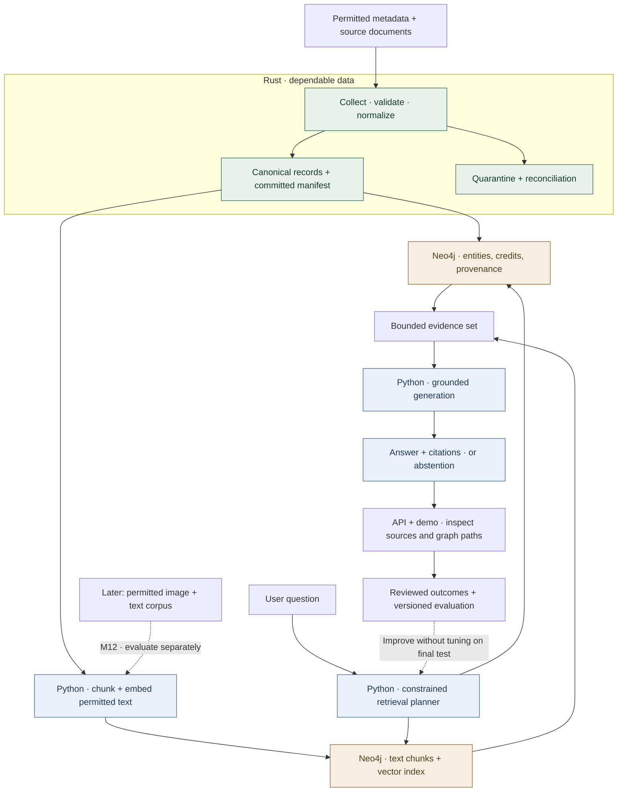
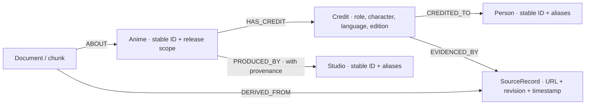

# AniGraph — proposed architecture

Status: design proposal. The components below are not yet implemented in this repository.

## Data and answer flow

The Rust pipeline owns dependable input snapshots; Python owns AI behavior. Begin with one machine, one fixture and one Neo4j instance. No Kafka, Kubernetes or separate vector database is required by the initial design.

## Graph model

Do not collapse every participation record into a generic `WORKED_ON` edge. A credit needs a role, work/release scope, source and optional character/language. Directors and voice actors are people with credit roles, not mutually exclusive person types. Co-productions, renamed studios and aliases need explicit policies.

## Example query semantics

For a selected director and studio, find matching works within the snapshot; select voice-acting credits within the requested language/edition; count distinct work IDs per actor. Return the observed work list and evidence alongside the count. Missing credits are unknown, and incomplete coverage must be shown.

## Ingestion and publication

1. Read a fixture or approved source under bounded concurrency and source-specific request limits.
2. Preserve source identity and version; validate canonical fields.
3. Quarantine invalid records and reconcile input outcomes.
4. Stage files, compute checksums and publish a committed manifest using the storage system's supported atomic/conditional operation.
5. Load the graph idempotently. Index text and vectors against the same snapshot/revision.

Consumers read committed manifests, not all files in a directory. Deletion propagates to graph assertions, text chunks, vectors and relevant answer caches. A changed embedding model requires a compatible rebuilt index, not mixing vector dimensions or meanings in place.

## Retrieval and generation boundary

- Start with approved parameterized Cypher templates for exact questions.
- Let a constrained Python planner choose templates, resolved IDs and retrieval options; treat model output as untrusted input.
- Enforce read-only credentials, timeouts, maximum graph hops and result limits outside the prompt.
- Retrieve text evidence for semantic questions and combine only relevant graph neighborhoods.
- Generate a supported answer with stable source references; clarify ambiguous entities and abstain when evidence is insufficient.
- Log source/index/model/prompt versions and request IDs. Keep secrets and unrestricted document text out of ordinary logs.

## Deployment and failures

The first pilot can use a Rust ingestion job, a Python API/demo and one Neo4j deployment. Define budgets before choosing hosting. Ingestion may be temporarily unavailable without making an existing committed snapshot unreadable; the UI must show its age. A model timeout returns an unavailable/partial-evidence state, not invented prose.

Roll back a compatible set of graph snapshot, text index, model/tokenizer, prompt and application versions. Rehearse restoring that set. Authentication and source-specific permissions are required before a multi-user or private-document pilot.

## Decisions to record

| Decision | Initial proposal | Revisit when |
|---|---|---|
| Project scope | Curated, traceable sample | Coverage analysis supports expansion |
| Rust/Python boundary | Files + versioned manifest | Measured latency/ownership needs a service or extension |
| Retrieval storage | Neo4j graph + vector index | Workload or deployment evidence supports another index |
| Query execution | Approved parameterized templates | A validated constrained query language is necessary |
| Inference runtime | Python first | A native runtime demonstrates matched quality and operating benefits |
| Multimodal scope | One image-plus-text task after text baseline | Rights, labelled data and evaluation support another modality |

Use [MILESTONE-TEMPLATE.md](MILESTONE-TEMPLATE.md) for work evidence and record architectural decisions with options, constraints, chosen behavior and revisit trigger.
