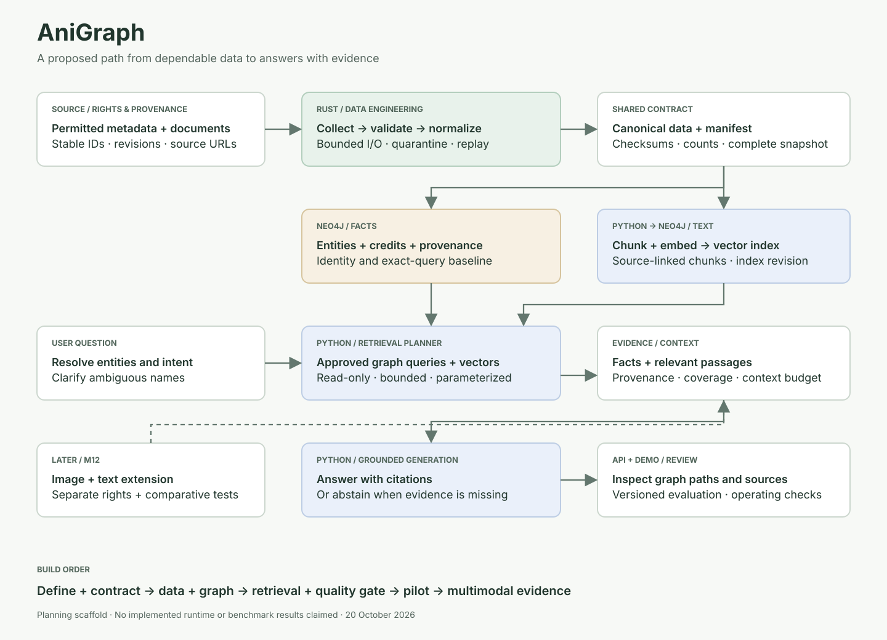
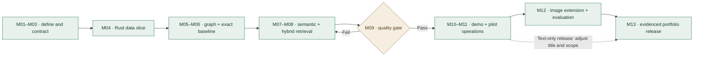

# AniGraph

**An evidence-first roadmap for anime knowledge-graph retrieval and generation.**

AniGraph aims to answer questions about anime titles, people, studios and production credits using source-linked graph facts and text evidence. The first release is deliberately text-first; an evaluated image-plus-text extension follows later.

> **Current state:** planning and documentation scaffold. The portfolio collection exists, but this repository does not yet implement ingestion, GraphRAG, a model endpoint or a deployed demo. Milestones below are proposed work, not completion claims. Prepared 20 October 2026.

[Complete roadmap](ROADMAP.md) · [Architecture](ARCHITECTURE.md) · [Milestone documentation template](MILESTONE-TEMPLATE.md) · [Portfolio form entries](PORTFOLIO-MILESTONES.md)

## Start with one question

“Within the indexed dataset, which voice actors have the most distinct anime credits on works directed by a specified director and produced by a specified studio?”

That question needs explicit identity, direction of relationships, language/edition scope, a definition of distinct credits, and an answer with provenance. It is a more useful first test than an unrestricted chatbot.

## Milestone sequence

| Phase | Milestones | Outcome |
|---|---|---|
| Foundation | M01–M03 | Scoped question set, reproducible project and a source-aware data contract |
| Trustworthy data | M04–M06 | Rust ingestion and an idempotent graph with an exact-query baseline |
| Grounded AI | M07–M09 | Semantic retrieval, hybrid GraphRAG and measured quality |
| Pilot | M10–M11 | Evidence-first API/demo, operating checks and recovery |
| Multimodal expansion | M12 | A permissioned image-plus-text task evaluated against text-only |
| Portfolio release | M13 | A reproducible case study with linked evidence and honest status |

## Responsibilities

- **Rust:** collection, bounded I/O, validation, normalization, replay-safe publication and data-quality reports.
- **Python:** text preparation, embeddings, retrieval planning, generation, evaluation and the initial API/demo.
- **Neo4j:** canonical graph facts, credit provenance, chunks and a compatible vector index. A second vector database is not required for the first version.
- **Shared contract:** stable IDs, source revisions, nulls, aliases, units/time semantics, schema versions and committed dataset manifests.

These are proposed design choices. Existing vectorized Python or database operations can stay where they are; custom Rust should have an ownership, packaging or measured performance reason.

## What to do now

1. Open [M01 in the roadmap](ROADMAP.md#m01--problem-framing-scope-and-success-criteria).
2. Copy [MILESTONE-TEMPLATE.md](MILESTONE-TEMPLATE.md) for the work log and attach evidence as you go.
3. Use [the portfolio entries](PORTFOLIO-MILESTONES.md) to create your timeline items under the AniGraph collection.
4. Start each item at `0 / 5`; update a unit only after its corresponding deliverable has passed review.
5. Implement one synthetic fixture end to end before collecting a large dataset.

There is no application quickstart yet because runtime code has not been added. M02 defines the reproducible implementation setup.

## Repository guide

| File | Purpose |
|---|---|
| [ROADMAP.md](ROADMAP.md) | Thirteen milestones, dependencies, five deliverables each, acceptance gates and evidence |
| [ARCHITECTURE.md](ARCHITECTURE.md) | Data flow, ontology, language boundaries, failure handling and decisions |
| [DATA-CONTRACT.md](DATA-CONTRACT.md) | Canonical records, source manifests, credit identity and compatibility |
| [EVALUATION.md](EVALUATION.md) | Benchmark plan, baselines, metrics and release criteria |
| [MILESTONE-TEMPLATE.md](MILESTONE-TEMPLATE.md) | Repeatable milestone write-up and proof of completion |
| [PORTFOLIO-MILESTONES.md](PORTFOLIO-MILESTONES.md) | Copy-ready fields matching the existing portfolio form |
| [portfolio-milestones.json](portfolio-milestones.json) | Thirteen proposed API payloads; data only, never auto-submitted |
| [architecture.svg](architecture.svg) / [architecture.mmd](architecture.mmd) | Static architecture image and editable Mermaid source |
| [roadmap.mmd](roadmap.mmd) | Editable milestone flowchart |
| [SOURCES.md](SOURCES.md) | Official documentation and source-selection notes |

## Completion policy

Documentation written ≠ feature implemented ≠ quality evaluated ≠ pilot deployed. A milestone is complete only when its deliverables, acceptance gate and linked evidence are present. Record actual dates and measurements when work happens; do not manufacture historic progress.

The portfolio website is a separate React/FastAPI/Supabase application. It displays the project narrative; it is not the AniGraph graph database or AI runtime. See [the integration notes](PORTFOLIO-MILESTONES.md#how-these-map-to-the-existing-website).

## Scope boundaries

The MVP does not claim complete industry coverage, identify private individuals, infer production credits from visual style, or execute unrestricted model-generated database commands. General audio/video understanding and broad autonomous web scraping are future decisions.

## References

See [official sources and design rationale](SOURCES.md). GitHub renders the Mermaid diagrams in these Markdown files; the SVG provides a static alternative.
