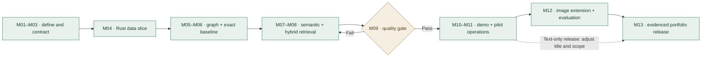

# AniGraph — complete milestone roadmap

Status: proposed roadmap · Prepared 20 October 2026 · No completion percentages have been inferred.

Work by acceptance gates rather than promised dates. M01 starts first; parallel work is useful only when its dependencies and contracts are settled. Every milestone has five deliverables, so progress can be recorded as completed deliverables out of five.

## Dependency and release flow

## Milestone index

| Milestone | Dependencies | Release scope |
|---|---|---|
| M01 — Problem framing, scope and success criteria | None | Text-first MVP |
| M02 — Repository, reproducible environment and development checks | M01 | Text-first MVP |
| M03 — Source selection, provenance and shared data contract | M01, M02 | Text-first MVP |
| M04 — Rust ingestion and replay-safe dataset publication | M03 | Text-first MVP |
| M05 — Entity resolution and anime graph model | M03, M04 | Text-first MVP |
| M06 — Neo4j loading and deterministic graph-query baseline | M05 | Text-first MVP |
| M07 — Python text preparation and semantic-retrieval baseline | M04, M06 | Text-first MVP |
| M08 — Hybrid GraphRAG with bounded queries and cited answers | M06, M07 | Text-first MVP |
| M09 — Evaluation, failure analysis and performance evidence | M08 | Text-first MVP |
| M10 — API and evidence-first demonstration interface | M08, M09 | Text-first MVP |
| M11 — Deployment, monitoring and recovery | M09, M10 | Text-first MVP |
| M12 — Multimodal image extension and comparative evaluation | M09, M11 | Multimodal extension |
| M13 — Final case study, portfolio evidence and handover | M11, M12 | Final evidence |

## M01 — Problem framing, scope and success criteria

**Goal:** Define an answerable first version of AniGraph rather than claiming coverage of the whole anime industry.

**Depends on:** None · **Initial state:** planned · **Progress:** 0 / 5

### Deliverables

- [ ] Write the target user, decision and five representative questions.
- [ ] Set MVP boundaries: a curated, source-permitted sample of anime, people, studios and credits.
- [ ] Separate exact graph questions, semantic questions, unsupported questions and future image questions.
- [ ] Define measurable quality, latency and operating-cost targets before tuning.
- [ ] Publish the scope matrix, assumptions and initial architecture decision.

**Acceptance gate:** A reviewer can identify what the MVP will answer, what it will refuse and how success will be measured.

### Evidence to record

- Problem statement and scope matrix
- Five question examples with expected evidence
- Acceptance-target decision record

**Watch for:** A detailed plan is not proof of an implemented capability.

**Milestone write-up:** copy [MILESTONE-TEMPLATE.md](MILESTONE-TEMPLATE.md); include the actual decisions, evidence, result, limitation and next step.

## M02 — Repository, reproducible environment and development checks

**Goal:** Make one small fixture reproducible before adding production services.

**Depends on:** M01 · **Initial state:** planned · **Progress:** 0 / 5

### Deliverables

- [ ] Choose and record compatible Rust, Python and Neo4j versions; create isolated environments.
- [ ] Establish Rust ingestion and Python AI packages with one documented local command each.
- [ ] Add dependency locks, an environment-variable example without credentials and ignored local data.
- [ ] Add formatting, unit-test and shared-contract checks to CI.
- [ ] Verify a clean checkout can validate the synthetic fixture without external API keys.

**Acceptance gate:** A clean checkout passes documented local and CI checks; no source datasets or credentials are required for the fixture path.

### Evidence to record

- Environment/setup guide
- Lockfiles and example configuration
- CI run and fixture output

**Watch for:** The documentation scaffold in this repository does not establish that the runtime or CI has been implemented.

**Milestone write-up:** copy [MILESTONE-TEMPLATE.md](MILESTONE-TEMPLATE.md); include the actual decisions, evidence, result, limitation and next step.

## M03 — Source selection, provenance and shared data contract

**Goal:** Decide which facts and documents can be used and preserve where every claim came from.

**Depends on:** M01, M02 · **Initial state:** planned · **Progress:** 0 / 5

### Deliverables

- [ ] Choose an initial source after checking its API terms, reuse conditions and coverage.
- [ ] Record source URLs, retrieval times, revisions, permitted fields, attribution and retention decisions.
- [ ] Define canonical anime/person/studio/credit records with stable IDs, nulls and language-aware aliases.
- [ ] Add synthetic valid, malformed, duplicate, missing-credit and conflicting-name fixtures.
- [ ] Specify committed manifests, checksums, deletion, reconciliation and schema-evolution rules.

**Acceptance gate:** Every fixture record validates, every fact has provenance, and a source-coverage matrix identifies missing information.

### Evidence to record

- Source register and coverage matrix
- Versioned contract and shared fixtures
- Schema validation and reconciliation examples

**Watch for:** An API being reachable does not mean all fields, images or linked interviews can be republished.

**Milestone write-up:** copy [MILESTONE-TEMPLATE.md](MILESTONE-TEMPLATE.md); include the actual decisions, evidence, result, limitation and next step.

## M04 — Rust ingestion and replay-safe dataset publication

**Goal:** Turn one allowed source or fixture into a trustworthy, repeatable input snapshot for AI.

**Depends on:** M03 · **Initial state:** planned · **Progress:** 0 / 5

### Deliverables

- [ ] Implement a bounded Rust collector/parser with explicit request deadlines and source-rate handling.
- [ ] Normalize identifiers, timestamps, language tags and missing values without inventing facts.
- [ ] Quarantine malformed records with stable reason codes and restricted diagnostic context.
- [ ] Deduplicate by source identity/revision, reconcile counts and write a staged canonical snapshot.
- [ ] Publish a complete manifest and test interrupted runs, retry limits and replay.

**Acceptance gate:** Running the same input twice produces the same logical dataset, and consumers cannot read a partially published snapshot.

### Evidence to record

- Input/output manifests and checksums
- Quarantine/reconciliation report
- Replay and interrupted-run tests

**Watch for:** Use controlled retries and backpressure; unbounded async work can exhaust memory or violate source limits.

**Milestone write-up:** copy [MILESTONE-TEMPLATE.md](MILESTONE-TEMPLATE.md); include the actual decisions, evidence, result, limitation and next step.

## M05 — Entity resolution and anime graph model

**Goal:** Model credits and relationships precisely enough to support reliable multi-hop answers.

**Depends on:** M03, M04 · **Initial state:** planned · **Progress:** 0 / 5

### Deliverables

- [ ] Define Anime, Person, Studio and Credit identities; use a credit entity to preserve role, character, language and evidence.
- [ ] Document relationship direction and the difference between production, licensing and distribution.
- [ ] Resolve aliases and external IDs while preserving ambiguous identities for review.
- [ ] Specify release/version scope, co-productions, missing credits and conflicting-source behavior.
- [ ] Create a hand-checked miniature graph and expected multi-hop query answers.

**Acceptance gate:** The miniature graph answers the benchmark credit questions without merging distinct people or treating missing credits as negative evidence.

### Evidence to record

- Ontology diagram and identity policy
- Alias/conflict examples
- Hand-checked graph fixture and expected answers

**Watch for:** A name match is not enough to merge people; voice credits can differ by language, edition or character.

**Milestone write-up:** copy [MILESTONE-TEMPLATE.md](MILESTONE-TEMPLATE.md); include the actual decisions, evidence, result, limitation and next step.

## M06 — Neo4j loading and deterministic graph-query baseline

**Goal:** Prove the graph is useful without an LLM.

**Depends on:** M05 · **Initial state:** planned · **Progress:** 0 / 5

### Deliverables

- [ ] Create uniqueness constraints and indexes appropriate to the chosen Neo4j version.
- [ ] Implement idempotent loading keyed by canonical IDs and explicit update/deletion handling.
- [ ] Use an ingestion identity with write permission and a separate application read-only identity.
- [ ] Implement parameterized query templates for cast, staff, studio and bounded collaboration counts.
- [ ] Compare fixture query results and replay behavior with the hand-checked expected outputs.

**Acceptance gate:** Exact fixture questions return the expected entities, counts and provenance; repeated loading creates no duplicates.

### Evidence to record

- Schema/constraint and query files
- Baseline results with source IDs
- Load/reload/deletion tests

**Watch for:** Counts mean credits observed in this indexed snapshot, not a complete ranking across the entire industry.

**Milestone write-up:** copy [MILESTONE-TEMPLATE.md](MILESTONE-TEMPLATE.md); include the actual decisions, evidence, result, limitation and next step.

## M07 — Python text preparation and semantic-retrieval baseline

**Goal:** Retrieve relevant text with attributable evidence before generating answers.

**Depends on:** M04, M06 · **Initial state:** planned · **Progress:** 0 / 5

### Deliverables

- [ ] Use permitted or self-authored text, preserving document IDs, source revisions and offsets.
- [ ] Define chunking, language handling, text normalization and content-hash-based reindexing.
- [ ] Choose an embedding model and pin tokenizer/model/preprocessing versions.
- [ ] Store chunks and vectors in a compatible Neo4j vector index initially, with dimension checks.
- [ ] Evaluate retrieval on labelled queries and verify document deletion removes derived chunks/vectors.

**Acceptance gate:** Relevant evidence is retrievable with stable citations, and index versions and deletion behavior are reproducible.

### Evidence to record

- Chunk examples and source references
- Model/index manifest
- Retrieval and deletion results

**Watch for:** Good vector similarity does not prove the retrieved passage supports the answer.

**Milestone write-up:** copy [MILESTONE-TEMPLATE.md](MILESTONE-TEMPLATE.md); include the actual decisions, evidence, result, limitation and next step.

## M08 — Hybrid GraphRAG with bounded queries and cited answers

**Goal:** Combine graph facts and text evidence while preserving a clear boundary between facts and generated explanation.

**Depends on:** M06, M07 · **Initial state:** planned · **Progress:** 0 / 5

### Deliverables

- [ ] Route exact questions to approved graph templates and semantic questions to retrieval.
- [ ] Combine bounded graph neighborhoods and relevant text under a context budget.
- [ ] Generate answers with entity/source citations and explicit snapshot/coverage scope.
- [ ] Abstain or ask for clarification when evidence is missing, conflicting or ambiguous.
- [ ] Enforce read-only query execution, parameters, timeouts and result limits independently of model instructions.

**Acceptance gate:** A traced example shows question, retrieval plan, evidence, bounded query and supported response; unsafe requests cannot write to the graph.

### Evidence to record

- Three end-to-end answer traces
- Citation and abstention examples
- Query-boundary and injection tests

**Watch for:** Do not execute arbitrary generated Cypher. Start with approved templates and a constrained planner.

**Milestone write-up:** copy [MILESTONE-TEMPLATE.md](MILESTONE-TEMPLATE.md); include the actual decisions, evidence, result, limitation and next step.

## M09 — Evaluation, failure analysis and performance evidence

**Goal:** Measure whether GraphRAG adds value over simpler baselines.

**Depends on:** M08 · **Initial state:** planned · **Progress:** 0 / 5

### Deliverables

- [ ] Freeze a proposed pilot set of at least 50 labelled questions, stratified by exact, multi-hop, semantic and unanswerable cases.
- [ ] Separate development and final test questions; prevent paraphrase and entity-family leakage.
- [ ] Compare deterministic graph queries, vector-only RAG and hybrid GraphRAG under matched conditions.
- [ ] Measure answer correctness, retrieval recall, citation support, abstention, latency and cost.
- [ ] Publish failures, denominators, uncertainty and a release decision without tuning on the final test set.

**Acceptance gate:** A reproducible report meets the targets chosen in M01 or documents why the system remains an experiment.

### Evidence to record

- Versioned benchmark and split policy
- Baseline comparison with raw results
- Failure analysis and release decision

**Watch for:** Fifty questions is a proposed pilot, not proof of general reliability; model-based judges require human spot checks.

**Milestone write-up:** copy [MILESTONE-TEMPLATE.md](MILESTONE-TEMPLATE.md); include the actual decisions, evidence, result, limitation and next step.

## M10 — API and evidence-first demonstration interface

**Goal:** Let a user inspect an answer and the evidence behind it.

**Depends on:** M08, M09 · **Initial state:** planned · **Progress:** 0 / 5

### Deliverables

- [ ] Expose a typed Python query API with validated inputs, request IDs and structured errors.
- [ ] Build a small demo UI with question examples, citations, graph paths and index freshness.
- [ ] Display missing-evidence and service-unavailable states without implying certainty.
- [ ] Add request deadlines, input/context limits and per-user limits appropriate to the pilot.
- [ ] Run end-to-end cases for successful, ambiguous, unsupported and failed requests.

**Acceptance gate:** A new user can ask a supported question, inspect its evidence and understand the system limits.

### Evidence to record

- API contract and request examples
- Demo screenshots or recording
- End-to-end and usability findings

**Watch for:** A polished demo must not hide retrieval failure or promote an unsupported answer as a fact.

**Milestone write-up:** copy [MILESTONE-TEMPLATE.md](MILESTONE-TEMPLATE.md); include the actual decisions, evidence, result, limitation and next step.

## M11 — Deployment, monitoring and recovery

**Goal:** Operate a limited pilot with traceable artifacts and a tested way to recover.

**Depends on:** M09, M10 · **Initial state:** planned · **Progress:** 0 / 5

### Deliverables

- [ ] Package a documented deployment with pinned artifacts, secret configuration and health checks.
- [ ] Separate ingestion and serving permissions; verify access, deletion and log-minimization behavior.
- [ ] Measure realistic concurrency, latency, memory and infrastructure/model cost.
- [ ] Correlate request traces with source/index/model revisions and monitor stale data and failure rates.
- [ ] Rehearse backup/restore and rollback to a compatible graph, text index, model and application version.

**Acceptance gate:** The pilot passes its operating budget and service targets, and a second person can follow the runbook to recover it.

### Evidence to record

- Deployment record and resource budget
- Load-test and monitoring examples
- Restore/rollback drill and runbook

**Watch for:** Availability is not answer quality. Collect labelled outcomes or reviewed samples after launch.

**Milestone write-up:** copy [MILESTONE-TEMPLATE.md](MILESTONE-TEMPLATE.md); include the actual decisions, evidence, result, limitation and next step.

## M12 — Multimodal image extension and comparative evaluation

**Goal:** Earn the multimodal claim with one narrow, permissioned image-plus-text use case.

**Depends on:** M09, M11 · **Initial state:** planned · **Progress:** 0 / 5

### Deliverables

- [ ] Choose one image task and an explicitly permitted or self-authored evaluation corpus.
- [ ] Record asset ownership, IDs, provenance, transforms and allowed display/retention.
- [ ] Implement image embeddings or vision extraction linked to the existing source/entity graph.
- [ ] Measure image-plus-text performance against the text-only baseline on a held-out set.
- [ ] Document hallucination, mismatch, accessibility and deletion cases; retain the extension only if useful.

**Acceptance gate:** A reproducible multimodal example and comparison report show supported benefit and remaining failures.

### Evidence to record

- Asset/source manifest and one complete trace
- Matched text-only vs multimodal results
- Known limitations and accessible demo

**Watch for:** Posters or screenshots are not automatically reusable. Audio/video extensions are separate future decisions.

**Milestone write-up:** copy [MILESTONE-TEMPLATE.md](MILESTONE-TEMPLATE.md); include the actual decisions, evidence, result, limitation and next step.

## M13 — Final case study, portfolio evidence and handover

**Goal:** Publish an honest, reproducible portfolio story backed by artifacts and measured results.

**Depends on:** M11, M12 · **Initial state:** planned · **Progress:** 0 / 5

### Deliverables

- [ ] Write the problem, implemented scope, architecture, decisions and trade-offs in the case study.
- [ ] Link specific commits, datasets/manifests, evaluation reports and reproducible demo instructions.
- [ ] Replace proposed targets with actual measured results and identify unimplemented features.
- [ ] Document the operating runbook, known limits, remaining backlog and ownership.
- [ ] Update the portfolio narrative, milestone evidence, GitHub link and status to match verified work.

**Acceptance gate:** A reviewer can reproduce one result and distinguish implemented, evaluated, deployed and future capabilities.

### Evidence to record

- Final case study and demo
- Reproducibility checklist
- Portfolio entries linked to evidence

**Watch for:** If M12 is deferred, a text-first release can close here only with the public title and scope explicitly adjusted; do not claim completed multimodal capability.

**Milestone write-up:** copy [MILESTONE-TEMPLATE.md](MILESTONE-TEMPLATE.md); include the actual decisions, evidence, result, limitation and next step.

## Progress and release rules

- `planned`: queued work. `in-progress`: an owner is actively working. `completed`: all five deliverables and the gate are evidenced.
- Use `current / 5` as a deliverable count, not elapsed time or an estimate of model quality. Do not average these percentages into an overall project estimate: milestone effort differs.
- A text-only release can precede M12, but its title and case study must say text-first. The full multimodal release requires the M12 comparison and evidence.
- Reopen the relevant milestone when data contracts, source rights, graph schema, model revisions or user requirements change materially.
- The final benchmark remains held out. Failed quality gates trigger a revision or a narrower release, not a rewritten success threshold.
